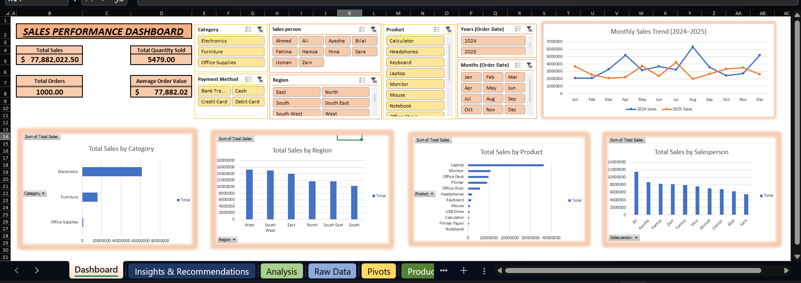

# Excel Sales Performance Dashboard

## Project Overview
This project presents an interactive Sales Performance Dashboard built in Microsoft Excel to analyze sales transactions and generate meaningful business insights.

The dashboard helps monitor key performance indicators (KPIs), compare sales across products, categories, regions, and salespersons, and analyze monthly sales trends.
## Dashboard Preview

## Dashboard Features
- Interactive KPI tracking
- Total Sales, Total Orders, Total Quantity, and Average Order Value
- Sales analysis by product and category
- Regional sales performance comparison
- Salesperson performance analysis
- Monthly sales trend comparison for 2024 and 2025
- Interactive slicers for filtering and exploring data
- Business insights and recommendations

## Tools & Skills
- Microsoft Excel
- Data Cleaning
- Data Analysis
- Excel Formulas
- PivotTables and PivotCharts
- Interactive Slicers
- Data Visualization
- Business Intelligence

## Key Performance Indicators

| KPI | Result |
|---|---:|
| Total Sales | Rs. 77,882,022.50 |
| Total Orders | 1,000 |
| Total Quantity Sold | 5,479 |
| Average Order Value | Rs. 77,882.02 |

## Key Business Insights

- **Top-Selling Product:** Laptop
- **Lowest-Selling Product:** Notebook
- **Top-Performing Category:** Electronics
- **Lowest-Performing Category:** Office Supplies
- **Top-Performing Region:** West
- **Lowest-Performing Region:** South
- **Top Salesperson:** Ali
- **Lowest Salesperson:** Sara

### Monthly Sales Trends
- **2024:** August recorded the highest sales, while February recorded the lowest.
- **2025:** July recorded the highest sales, while August recorded the lowest.

## Business Recommendations

- Maintain sufficient inventory of high-performing products such as Laptops.
- Review the sales performance of low-performing products and categories.
- Investigate regional sales differences to identify opportunities for improvement.
- Analyze salesperson performance to identify best practices and training needs.
- Use monthly sales trends to support sales planning and inventory decisions.

## Project Files

- `Excel_Sales_Performance_Dashboard_Final.xlsx.xlsx` — Final Excel dashboard workbook.

## Author

**Aqdas Shaikh**

[GitHub Profile](https://github.com/aqdasshaikh1)
